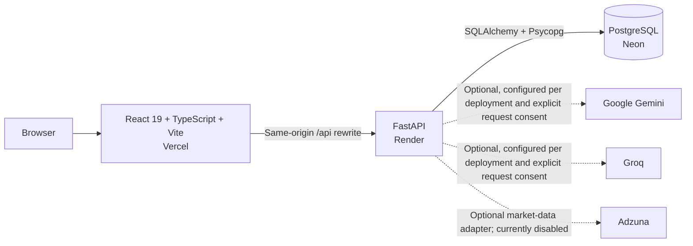
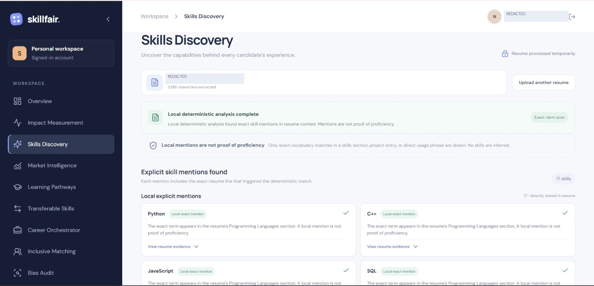
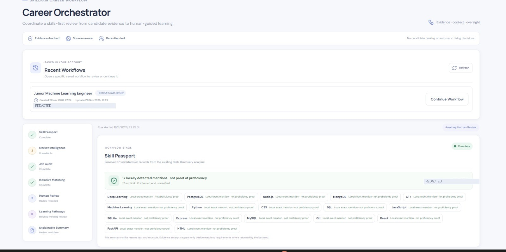
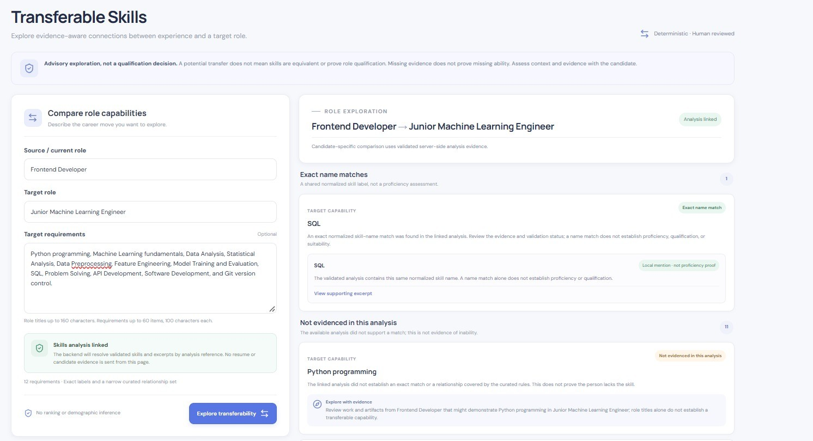
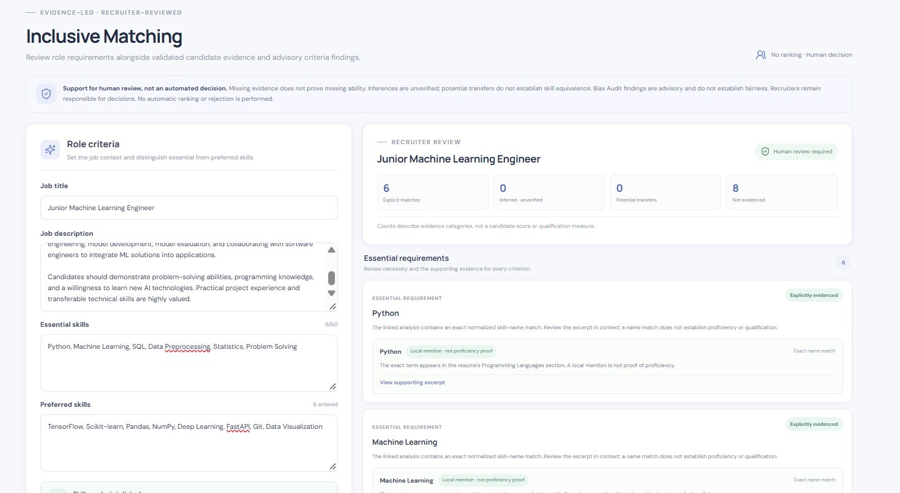
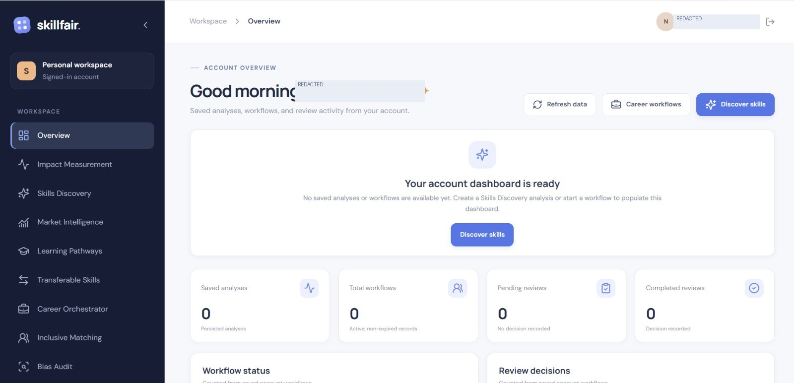

<div align="center">

# SkillFair

### Skills-first hiring, with people in control.

SkillFair is a portfolio prototype for evidence-backed, human-guided recruiting. It helps reviewers explore demonstrated skills and experience alongside role requirements, while making uncertainty visible and keeping decisions with people.

<p>
  <a href="https://skill-fair.vercel.app/"></a>
</p>

<p>
  
  
  
  
  
</p>

<p><sub>Controlled portfolio demo · Not production-grade or enterprise-certified</sub></p>

</div>

> **Human decision boundary:** SkillFair supports human decision-making. It does not automatically rank, reject, select, or hire candidates. Evidence coverage is not a competence score, and an advisory finding is not proof of unfairness or legal non-compliance.

## Contents

- [🎯 Project Overview](#project-overview)
- [✨ Key Features](#key-features)
  - [👤 Skills Discovery & Skill Passport](#skills-discovery--skill-passport)
  - [🎯 Job Matching](#job-matching)
  - [⚖️ Job Requirement & Bias Audit](#job-requirement--bias-audit)
  - [🔄 Transferable Skills](#transferable-skills)
  - [🌍 Inclusive Matching](#inclusive-matching)
  - [📚 Learning Pathways](#learning-pathways)
  - [📈 Market Intelligence](#market-intelligence)
  - [📊 Impact Measurement](#impact-measurement)
  - [🚀 Career Orchestrator](#career-orchestrator)
  - [🧑‍💼 Recruiter Review & Dashboard](#recruiter-review--dashboard)
  - [🔔 Notifications, Search & Data Management](#notifications-search--data-management)
- [🏗️ System Architecture](#system-architecture)
- [🛠️ Technology Stack](#technology-stack)
  - [🗃️ Migration Status by Environment](#migration-status-by-environment)
- [📂 Project Structure](#project-structure)
- [🖥️ Screenshots](#screenshots)
- [⚙️ Installation & Setup](#installation--setup)
- [🧪 Testing & Validation](#testing--validation)
- [🔐 Security & Privacy](#security--privacy)
- [☁️ Deployment](#deployment)
- [⚠️ Current Limitations](#current-limitations)
- [🔮 Future Improvements](#future-improvements)
- [📄 License](#license)

<a id="project-overview"></a>
## 🎯 Project Overview

Hiring reviews can over-weight titles, credentials, or keyword matches and miss relevant capabilities gained through different roles or career paths. SkillFair explores a more transparent workflow: surface resume-supported evidence, compare it with role requirements, explain potential relationships and concerns, and leave interpretation and decisions to a human reviewer.

Missing resume evidence is not proof that a person lacks a skill. A possible transfer is not proof of proficiency. A clear audit is not proof that a job or process is fair.

The application uses PostgreSQL for registered account-owned analyses, workflows, review decisions, Bias Audits, notifications, and Impact Measurement records. In-memory stores are used only by isolated domain/test adapters.

<a id="key-features"></a>
## ✨ Key Features

<a id="skills-discovery--skill-passport"></a>
### 👤 Skills Discovery & Skill Passport

`POST /api/skills/discover` accepts PDF/DOCX resumes within the configured upload limit, extracts text, and presents validated skill mentions with supporting excerpts. Explicit evidence is distinguished from inferred, unverified skills. With no AI provider configured, deterministic local analysis remains available. The response returns a character count rather than the full extracted text; validated evidence is temporarily associated with an opaque `analysis_id` for later requests. The provenance store does not retain full resume text. The Skill Passport is a concise workflow summary, not a verified credential wallet or permanent candidate profile.

Job Audit uses the shared authenticated API client, including cookies, CSRF, account-change cancellation, and a bounded request timeout. Resume uploads retain upload progress and use a bounded timeout; uploads are not automatically retried because the server may already have completed the analysis. After a timeout, check saved analyses before manually retrying.

<a id="job-matching"></a>
### 🎯 Job Matching

`POST /api/jobs/match` compares an analysis with recruiter-entered requirements using deterministic, case-insensitive normalized exact-name matching. It returns supported evidence, requirements missing from the analysis, counts, and an evidence-coverage calculation. Coverage is not a competence score, qualification judgment, or hiring outcome. Adjacent capabilities are handled separately by Transferable Skills and Inclusive Matching.

<a id="job-requirement--bias-audit"></a>
### ⚖️ Job Requirement & Bias Audit

`POST /api/jobs/audit` runs deterministic checks for selected credential requirements, potentially exclusionary or vague wording, experience thresholds, and explicit employment-continuity restrictions. Findings are advisory prompts for human review; they do not prove discrimination, unfairness, or legal compliance, and no finding does not establish fairness. The authenticated Bias Audit workspace can save the result snapshot and per-finding review selections without storing the full job description. Saved audit history is owner-scoped and can be restored or deleted.

<a id="transferable-skills"></a>
### 🔄 Transferable Skills

`POST /api/skills/transferability` compares a source role with a target role and optional requirements. With an `analysis_id`, it uses server-held validated evidence; without one, it offers general role exploration without candidate-specific claims. Exact matches are separate from a small set of curated adjacent-capability relationships. A potential transfer is not equivalence or proof of qualification.

<a id="inclusive-matching"></a>
### 🌍 Inclusive Matching

`POST /api/jobs/inclusive-match` evaluates essential and preferred requirements against server-held evidence and returns requirement-level evidence states, explanations, applicable advisory audit findings, and human-review prompts. It does not infer sensitive characteristics, rank or automatically reject applicants, or establish that a process is inclusive or fair.

<a id="learning-pathways"></a>
### 📚 Learning Pathways

`POST /api/learning/pathways` returns deterministic exercises, project prompts, and ways to demonstrate requested skills. Suggestions are not verified courses, certifications, completed training, or proof of competence. When linked to an analysis, results distinguish explicit, inferred, and not-evidenced states; missing resume evidence does not prove missing ability.

<a id="market-intelligence"></a>
### 📈 Market Intelligence

`POST /api/market/intelligence` accepts a role title, supported country code (India is the default), optional location, and up to five recruiter-entered skill keywords. `GET /api/market/provider-status` reports provider availability without returning credentials. Adzuna is optional and disabled by default; activation requires server-side credentials, `SKILLFAIR_MARKET_PROVIDER=adzuna`, and an explicit `SKILLFAIR_ADZUNA_USAGE_APPROVED=true` operator attestation. Supported responses are limited role-title and role-plus-keyword ad-count observations, not market censuses. The typed provider boundary validates source attribution, retrieval time, observation period, calculation method, and quality labels.

Valid results are cached in bounded process memory for 15 minutes; eligible stale results may be served for up to 24 hours after a provider outage with a warning. Cache entries are not shared across workers. Ad counts do not support emerging/declining skill histories, verified transferable-skill relationships, or candidate skill gaps; those remain unavailable rather than inferred. India is a supported country code, but actual listing coverage and quality are unverified. No live provider request or credentials are claimed. Adzuna terms require written permission for ongoing commercial analysis; organizational trial evaluation is limited to 14 days. Possible future sources include O*NET, BLS, and ESCO, but their taxonomies and projections must not be presented as live job-posting demand. See [Adzuna API overview](https://developer.adzuna.com/overview), [search endpoint](https://developer.adzuna.com/docs/search), [country-code specification](https://developer.adzuna.com/swagger/spec/test2.json), [terms](https://developer.adzuna.com/docs/terms_of_service), [O*NET licensing](https://www.onetcenter.org/database.html), [BLS projections](https://www.bls.gov/emp/documentation/data-overview.htm), and [ESCO API documentation](https://esco.ec.europa.eu/en/about-esco/escopedia/escopedia/esco-api).

<a id="impact-measurement"></a>
### 📊 Impact Measurement

Impact Measurement shows authenticated, per-account aggregates. Review timestamps, decisions, and confirmed Learning Pathways outcomes come from persisted workflows; voluntary recruiter ratings, candidate feedback, and manually entered baselines are associated with the signed-in account. Feedback and baselines are eligible for reporting for up to 90 days. Candidate feedback records application experience, accessibility, job-requirements clarity, and perceived fairness as separate 1–5 measures, with optional controlled improvement themes. It collects no free-text comments or candidate identifiers. Feedback is **not anonymous**; SkillFair does not verify respondents are candidates. Candidate dimensions and theme counts are separately reported and suppressed below five submissions for that account and reporting window. These self-reported prototype measures do not establish fairness, causation, or improved hiring outcomes.

<a id="career-orchestrator"></a>
### 🚀 Career Orchestrator

`POST /api/career/orchestrator/runs` coordinates a Skill Passport summary, Market Intelligence status, Job Audit, Inclusive Matching, human review, and Learning Pathways. Authenticated workflows and decisions are persisted in PostgreSQL and scoped to the account. The history endpoint lists up to 20 newest unexpired workflows with summary fields only; it omits job descriptions, skills lists, and detailed snapshots. Reopening fetches the selected owner-scoped run by its exact ID—there is no latest-workflow fallback. Review accepts `proceed`, `revise`, or `stop`; learning activities are generated only after a committed Proceed. Decisions attest to the signed-in account, not independently verified recruiter identity, and are not an immutable production audit record. Free-text review notes are not persisted.

<a id="recruiter-review--dashboard"></a>
### 🧑‍💼 Recruiter Review & Dashboard

Recruiter Review presents the current backend-backed workflow; it is not a multi-candidate queue. `GET /api/dashboard/overview` returns account-scoped counts for unexpired analyses and workflows, pending reviews, recorded decisions, workflow/review-state distributions, and recent workflow/review timestamps. It does not expose unique candidate counts, resume text, job descriptions, internal database IDs, or another account's records. The Overview dashboard also contains illustrative sample names and profile content; these are not live candidate records or measured hiring results.

<a id="notifications-search--data-management"></a>
### 🔔 Notifications, Search & Data Management

Notifications are transactionally created from persisted Human Review decisions. A Learning Pathways notification is created only for an outcome committed with Proceed. Notifications are owner-scoped, duplicate event keys are constrained per owner, retained rows are capped at 100 per account, and the API returns summaries only. Mark-as-read requires authentication, Origin validation, and CSRF protection.

Global Search is a bounded substring search over saved skill labels and record titles; it does not search resume excerpts, full resume text, or job descriptions. Selecting a result loads that exact owner-scoped analysis, workflow, or Bias Audit. Results are capped at 20. Data Management supports account-scoped record listing, bounded JSON export, and owner deletion of supported analyses/workflows. An analysis cannot be deleted while referenced by a workflow; workflow deletion removes its linked review records and related observations through reviewed foreign-key cascades. These deletions are permanent.

Settings currently store only a browser-local display name under a key scoped to the signed-in account ID. It does not synchronize across browsers. Theme/notification preferences, password recovery, MFA, email verification, organization switching, and a server-side account profile setting are not implemented.

<a id="system-architecture"></a>
## 🏗️ System Architecture



The frontend never receives provider credentials. Skills Discovery defaults to deterministic local analysis; an AI provider is optional and the current deployment may run with providers disabled. An AI-assisted request requires explicit provider-specific consent. Market Intelligence is separately unavailable until a verified provider is configured and returns supported, attributed data.

<a id="technology-stack"></a>
## 🛠️ Technology Stack

| Area | Technologies |
| --- | --- |
| **Frontend** | React 19, TypeScript, Vite, Tailwind CSS, Recharts, Lucide |
| **Backend** | Python, FastAPI, Pydantic, SQLAlchemy 2.x, Alembic, Psycopg 3 |
| **Database** | PostgreSQL; Neon for the hosted demo |
| **Optional AI** | Google Gemini or Groq, configured server-side; providers may be disabled |
| **Optional market data** | Adzuna integration is not active; no live market feed is claimed |
| **Deployment** | Vercel frontend, Render backend, Neon PostgreSQL; controlled non-commercial demo setup |
| **Quality** | Node.js test runner, pytest, TypeScript, ESLint, GitHub Actions |

<a id="migration-status-by-environment"></a>
### 🗃️ Migration Status by Environment

The migration chain is `202610310001` → `202611190001` → `202611190002`. Revision `202611190001` adds saved standalone Bias Audits and candidate feedback; `202611190002` adds account-owned workflow notifications.

- **Isolated PostgreSQL integration-test database** (`127.0.0.1:5440/skillfair_test_db`): revision `202611190002` was previously verified. It is reserved for the guarded PostgreSQL integration suite and is **not** the Playwright/browser E2E database.
- **Development database:** revision unknown / unverified.
- **Hosted Neon database:** revision unknown / unverified.

Endpoints that use M2.6/M2.7 schema changes require those migrations in the environment being used. Never infer one environment's migration state from another. The API does not create tables at startup.

<a id="project-structure"></a>
## 📂 Project Structure

```text
.
├── backend/
│   ├── app/                 # FastAPI routes, domain logic, persistence, models
│   ├── migrations/          # Alembic environment and versioned schema changes
│   ├── tests/               # Backend unit, API, security, persistence tests
│   ├── requirements*.txt    # Runtime, development, and pinned test dependencies
│   └── run-local.ps1        # Local Windows development launcher
├── docs/screenshots/        # Supplied application screenshots (identity details redacted)
├── src/
│   ├── components/          # React feature screens
│   ├── styles/              # Feature styles
│   └── *.ts(x)              # App, API/auth clients, and session state
├── tests/                   # Frontend Node.js tests
├── e2e/                     # Playwright journeys and synthetic API helpers
├── playwright.config.ts
├── vite.e2e.config.ts       # Isolated frontend-only E2E server configuration
├── .github/workflows/ci.yml # Frontend and backend CI
├── package.json
├── package-lock.json
├── render.yaml
└── vercel.json
```

<a id="screenshots"></a>
## 🖥️ Screenshots

These are captures of the supplied application screens. Account identifiers, resume filenames, and opaque record references have been visibly redacted; application content and behavior have not been altered.

<table>
  <tr>
    <th>Skills Discovery</th>
    <th>Career Orchestrator</th>
  </tr>
  <tr>
    <td></td>
    <td></td>
  </tr>
  <tr>
    <th>Transferable Skills</th>
    <th>Inclusive Matching</th>
  </tr>
  <tr>
    <td></td>
    <td></td>
  </tr>
  <tr><th colspan="2">Overview Dashboard</th></tr>
  <tr><td colspan="2" align="center"></td></tr>
</table>

**Additional captures still needed:** Job Requirement & Bias Audit results and Impact Measurement. Those screens were not included with this screenshot set, so no image is shown for them. When capturing, use synthetic data and keep sample-size and availability labels visible. Do not use real resumes, candidate data, credentials, or account details.

<a id="installation--setup"></a>
## ⚙️ Installation & Setup

### Requirements

- Node.js 22 and npm (the frontend lockfile is `package-lock.json`).
- Python 3.14.7 for the pinned backend test lock. Runtime dependency ranges support Python 3.11+, but regenerate and validate the lock before using another interpreter.
- A PostgreSQL database and a runtime-role `DATABASE_URL` for authenticated persistence features. Do not point development commands at production data.

### 🐍 Backend Setup

In PowerShell, from the repository root:

```powershell
cd backend
python -m venv .venv
.\.venv\Scripts\Activate.ps1
python -m pip install -r requirements-lock.txt
# From backend/, copy .env.example to .env only if .env does not already exist.
# Configure DATABASE_URL for the local runtime role; keep URLs private.
.\run-local.ps1
```

The backend reads `DATABASE_URL` for the restricted runtime application role and `SKILLFAIR_MIGRATION_DATABASE_URL` for Alembic migrations. Keep both URLs private and backend-only. The launcher uses the absolute backend `.env` path and its exact Vite development origins to avoid stale inherited origin settings. It is local-development-only; production must use an explicit origin allowlist. Never overwrite an existing `.env`. The launcher starts the API at `http://127.0.0.1:8000`; local health check: `http://127.0.0.1:8000/api/health`. The hosted API liveness endpoint is [`/api/health`](https://skillfair-api.onrender.com/api/health).

For schema changes, use a trusted local machine or controlled CI job with a separately configured migration role and direct database URL. Verify target host, port, database, and current revision before Alembic. Do not run migrations from application startup or against production without an approved backup/recovery plan.

### ⚛️ Frontend Setup

In a second PowerShell terminal, from the repository root:

```powershell
npm ci
npm run dev
```

Open the local URL printed by Vite. The development server proxies `/api` to the local FastAPI service. The backend launcher and environment setup are documented in [backend/README.md](backend/README.md).

<details>
<summary>API surface</summary>

| Method | Route | Purpose |
| --- | --- | --- |
| `GET` | `/api/health` | Backend liveness |
| `GET` | `/api/health/database` | Read-only database reachability status |
| `POST` | `/api/auth/register` · `/api/auth/login` · `/api/auth/logout` | Account and session lifecycle |
| `GET` | `/api/auth/me` | Current authenticated account |
| `GET` | `/api/search?q=...` | Bounded account-owned skill-label and saved-title search |
| `GET` | `/api/notifications?limit=20` | List account-owned workflow-event notification summaries |
| `POST` | `/api/notifications/{notification_id}/read` | Mark an owned notification as read; Origin and CSRF protected |
| `POST` | `/api/skills/discover` | Resume analysis and evidence extraction; full extracted text is not returned |
| `GET` | `/api/skills/analyses/latest` · `/api/skills/analyses/{analysis_id}` | Retrieve saved owner-scoped analysis and validated evidence |
| `POST` | `/api/jobs/match` | Deterministic exact-name requirement matching |
| `POST` | `/api/jobs/audit` | Advisory deterministic job-criteria audit |
| `POST` | `/api/jobs/audits` | Save audit result and review selections without full job description |
| `GET` | `/api/jobs/audits?limit=20` · `/api/jobs/audits/{audit_id}` | List or retrieve saved owner-scoped audits |
| `PATCH` · `DELETE` | `/api/jobs/audits/{audit_id}/findings/{finding_index}` · `/api/jobs/audits/{audit_id}` | Update a review selection or delete an owned audit; state changes require CSRF/origin checks |
| `POST` | `/api/jobs/inclusive-match` | Evidence-aware essential/preferred requirement review |
| `POST` | `/api/skills/transferability` · `/api/learning/pathways` | Exact/curated role exploration and deterministic learning suggestions |
| `POST` · `GET` | `/api/market/intelligence` · `/api/market/provider-status` | Provider-backed insights or unavailable status; never returns credentials |
| `GET` | `/api/impact/summary` | Account-only aggregate metrics with optional date/category filters |
| `POST` | `/api/impact/reviews/{run_id}/start` | Record idempotent Human Review start on a persisted workflow |
| `POST` | `/api/impact/feedback/recruiter` · `/api/impact/feedback/candidate` | Persist voluntary, account-associated ratings/survey responses for aggregate reporting |
| `POST` | `/api/impact/baseline-observations` | Persist an account's manually entered baseline duration |
| `POST` | `/api/career/orchestrator/runs` | Create a recruiter-led workflow run |
| `GET` | `/api/career/orchestrator/runs` · `/api/career/orchestrator/runs/{run_id}` | List summaries or retrieve one owner-scoped workflow |
| `POST` | `/api/career/orchestrator/runs/{run_id}/review` | Record Proceed, Revise, or Stop for an owned workflow |
| `GET` | `/api/dashboard/overview` | Account-scoped analysis/workflow metrics and recent workflow/review activity |
| `GET` | `/api/account/data` · `/api/account/export` | Page saved-record metadata or export bounded account-owned JSON |
| `DELETE` | `/api/account/analyses/{analysis_id}` · `/api/account/workflows/{workflow_id}` | Permanently delete owned records subject to reference/cascade rules |

State-changing authenticated requests use the existing CSRF and exact-origin protections. Request/response schemas are defined in `backend/app/models.py`; implementation and environment details are in [backend/README.md](backend/README.md).

</details>

### Optional AI providers

Local deterministic Skills Discovery works without an AI provider. An administrator may select `SKILLFAIR_LLM_PROVIDER=gemini` or `groq` in the backend environment. Gemini uses `SKILLFAIR_LLM_BASE_URL`, `SKILLFAIR_LLM_API_KEY`, and `SKILLFAIR_LLM_MODEL`; Groq uses the separate `SKILLFAIR_GROQ_API_KEY`, optional `SKILLFAIR_GROQ_MODEL`, and optional `SKILLFAIR_GROQ_MAX_COMPLETION_TOKENS`. Keep credentials out of source and frontend variables, and restart the backend after configuration changes. Each AI-assisted analysis requires explicit consent to send extracted resume text to the selected provider; there is no silent provider switch or fallback. Provider tests are mocked and do not establish live access, model availability, quota, pricing, or provider-side retention. See [backend/.env.example](backend/.env.example) and [backend/README.md](backend/README.md) for variable names and details; never publish secret values.

The repository ignores `.env` files and resume documents. Do not commit real resumes or other personal data.

<a id="testing--validation"></a>
## 🧪 Testing & Validation

Install dependencies as described above. Run backend commands from `backend` with its virtual environment active, then run frontend commands from the repository root.

### 🧪 Backend Checks

```powershell
python -m pip check
python -m compileall -q app tests
python -c "import app.main"
python -m pytest -q tests/test_auth.py tests/test_error_handlers.py tests/test_protections.py tests/test_security_headers.py
python -m pytest -q tests --ignore=tests/test_postgres_persistence_integration.py
$env:SKILLFAIR_RUN_POSTGRES_INTEGRATION = '0'
python -m pytest -q tests
```

PostgreSQL integration tests are separately opt-in. Keep `SKILLFAIR_RUN_POSTGRES_INTEGRATION=0` for the default run. To enable integration tests, use only the approved isolated SkillFair test database after the fail-closed guard verifies its exact target, runtime role, and migration revision. Never use development, hosted, or Permission-Aware RAG databases. CI explicitly disables PostgreSQL integration, has no external PostgreSQL URL/service, and does not run migrations; tests may use isolated in-memory SQLite.

### 🧪 Frontend Checks

```powershell
npm run typecheck
npm run lint
npm test
npm run build
```

Frontend unit/state tests use Node.js and are not interactive browser end-to-end tests. Browser E2E runs separately with Playwright. Install its pinned Chromium browser once with `npm run test:e2e:install`, then use `npm run test:e2e`. Playwright starts a dedicated Vite server at `127.0.0.1:4174` with dotenv disabled and no backend proxy. Fixtures intercept API requests with deterministic synthetic responses; unhandled requests cannot reach a backend. Journeys include authentication/session lifecycle, Skills Discovery, Career Orchestrator, Bias Audit, Impact Measurement and feedback, notifications, Market Intelligence, and account switching. These tests do not verify backend middleware, database transactions, or PostgreSQL persistence. The browser harness does not use a database or fall back to `DATABASE_URL`. Future backend-backed browser tests must use a separately selected E2E configuration and validate exact database identity and migration revision; the integration-test database is not approved for that purpose.

GitHub Actions runs on pushes and pull requests. It installs frontend dependencies with `npm ci`, uses the pinned backend test lock, runs Python syntax/import checks, focused backend security tests and the default backend suite, plus frontend typecheck, lint, tests and production build. CI sets `SKILLFAIR_RUN_POSTGRES_INTEGRATION=0`, has no external PostgreSQL service or URL, and runs no migrations, deployments, or artifact publishing.

<a id="security--privacy"></a>
## 🔐 Security & Privacy

- Authentication uses Argon2id password hashing and server-side opaque sessions; session tokens are stored as hashes. Cookies use `HttpOnly`, `SameSite=Lax`, and are `Secure` by default for HTTPS deployments.
- State-changing requests use CSRF and exact-origin checks. Analyses, Bias Audits, workflows, notifications, and feedback records are owner-scoped; IDs are locators, not authentication.
- Original resume files and complete extracted resume text are not intentionally persisted. Validated evidence excerpts and workflow snapshots may be stored in PostgreSQL. Multipart uploads can temporarily spool to operating-system temporary storage; the app does not claim that storage is encrypted.
- Candidate feedback is voluntary, account-associated, and **not anonymous**. SkillFair does not verify that a respondent is a candidate. Feedback and baselines are eligible for reporting for up to 90 days and are pruned by owner-scoped cleanup on relevant account requests; dormant accounts' expired records may remain until then.
- Analyses, workflow snapshots, and decisions do not automatically expire. Authenticated owners can export supported records and permanently delete their analyses/workflows through Data Management. Analysis deletion is blocked while workflows reference it; workflow deletion cascades to linked review records and related workflow observations. Account deletion and scheduled session-row cleanup are not implemented.
- Candidate feedback collects no free-text comments or candidate identifiers. Dimensions are reported separately and suppressed below five submissions for the account and selected reporting window. These controls do not verify respondent identity or demonstrate fairness.
- Do not enter real candidate data into the portfolio demo. It has not been independently certified, and no claim of legal compliance, fairness, security certification, or production readiness is made.

The account export is bounded to 250 rows per table, 1,000 total rows, and 2 MiB; oversized exports are rejected rather than returned partially. It contains supported account-owned profile, analysis, evidence, workflow, decision, feedback, and impact records. It excludes original resumes, complete extracted text, password/session/CSRF secrets, internal database IDs, and non-persisted review notes. Evidence excerpts use targeted PII redaction, which cannot reliably detect every name, address, or identifier.

<a id="deployment"></a>
## ☁️ Deployment

The hosted demo uses Vercel for the React frontend, a same-origin `/api/*` rewrite to the FastAPI service on Render, and PostgreSQL on Neon. The frontend, backend liveness, and database reachability have been checked during deployment verification; the API reports current health, which can change independently of this README. The configuration is for a **controlled, non-commercial portfolio demo**, not production or sensitive workloads. Render Free can spin down when idle, so the first API request may be delayed. Render and Vercel deployment controls are separate; verify the live service settings and coordinate backend/schema readiness before a production frontend deployment.

- [Backend liveness](https://skillfair-api.onrender.com/api/health) · [Database reachability](https://skillfair-api.onrender.com/api/health/database)
- Frontend routing and response headers: [`vercel.json`](vercel.json)
- Render service blueprint: [`render.yaml`](render.yaml)
- Backend setup, environment variables, and migrations: [`backend/README.md`](backend/README.md)

The checked-in Render blueprint specifies the `main` branch and `autoDeploy: false`; verify that the live Render service matches it. Vercel's Production Branch is a dashboard setting (expected to be `main`); a branch push can create a Preview without updating the production domain. Confirm deployment environment, source branch/commit, production branch, and deployment behavior in the hosting dashboards before release.

Render's backend environment requires `PYTHON_VERSION=3.14.7`, `SKILLFAIR_AUTH_COOKIE_SECURE=true`, `SKILLFAIR_LLM_PROVIDER=none`, exact HTTPS `SKILLFAIR_AUTH_ALLOWED_ORIGINS`, and a secret runtime `DATABASE_URL`. Use the Neon pooled URL for runtime traffic and a separately supplied direct URL with the migration role for controlled Alembic operations. Do not set `SKILLFAIR_MIGRATION_DATABASE_URL` on the running Render service. Never place database credentials or AI keys in Vercel frontend variables, README content, source control, or screenshots. Migrations do not run at application startup; verify the target identity, current revision, and backup/recovery readiness before migration. Development, test, and hosted migration states are environment-specific.

After an approved deployment, check `GET /api/health` through the same-origin Vercel `/api` route and use `GET /api/health/database` only for its safe reachability status. Authentication smoke testing should confirm unauthenticated `GET /api/auth/me` returns `401`, then exercise registration/login/logout and cookie/CSRF/session behavior with a dedicated demo account. Do not use real candidate data. Render Free can spin down after inactivity, delay the first request, and has ephemeral local storage; use PostgreSQL for persistence. Vercel marks `/api/*` responses `Cache-Control: no-store` and disables rewrite caching. The frontend CSP permits same-origin application/API traffic and the Google Fonts hosts used by `index.html`.

Deployed use requires HTTPS, `Secure` cookies, and exact allowed frontend origins. Vercel sets frontend document security headers; the API also sends browser security headers and `Cache-Control: no-store`, including on direct Render access. The TLS-terminating edge must provide HSTS. The backend does not trust forwarded-protocol or forwarded-client-IP headers; behind Vercel/Render, rate-limit buckets can therefore reflect a proxy peer rather than an individual browser. Use edge rate limits and request-body/read/idle limits; do not enable blanket forwarded-header trust. Application rate limiting is process-local and is not a substitute for edge protections. Render Free can spin down after inactivity, delay the first API request by around a minute, and has ephemeral local storage. Frontend API calls allow up to 90 seconds for wake-up and are not automatically retried; check saved state before manually retrying an operation.

<a id="current-limitations"></a>
## ⚠️ Current Limitations

- Market Intelligence has no active live data feed. Adzuna is currently disabled; do not interpret unavailable results as live market evidence.
- Candidate feedback is persisted as a voluntary, authenticated account-associated survey; it is not anonymous, and respondent identity as a candidate is not verified.
- Overview dashboard sample names, profiles, counts, and charts are illustrative, not live candidate data or measured outcomes.
- Impact measures are prototype/self-reported and do not establish causal effects, fairness, or real-world hiring outcomes.
- The app is a portfolio demonstration, not production-grade, enterprise-certified, or independently audited.
- Playwright journeys use synthetic mocked APIs; they do not verify backend middleware, PostgreSQL persistence, or production hosting behavior.

<a id="future-improvements"></a>
## 🔮 Future Improvements

- Connect a verified, attributed market-data source before presenting live market insights.
- Add and maintain interactive browser journeys for critical authentication and workflow flows.
- Define an approved retention schedule and account-deletion process for persistent records.
- Evaluate the workflow with an approved pilot and suitable baselines before making claims about fairness, time savings, or hiring outcomes.

No SAP integration is implemented or claimed.

<a id="license"></a>
## 📄 License

No open-source license is included in this repository. All rights are reserved unless a license is added.
